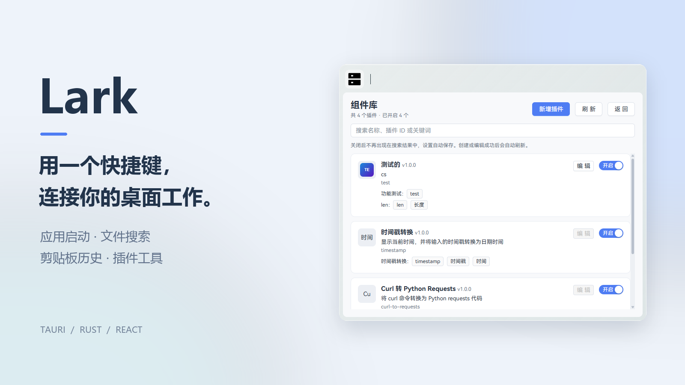
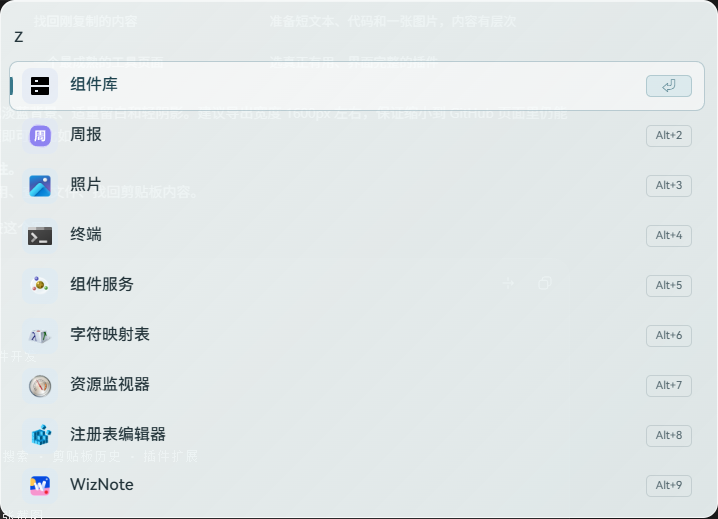
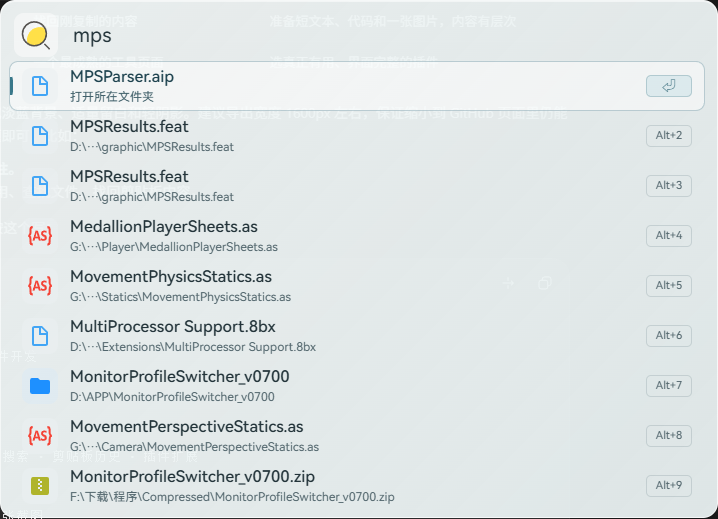
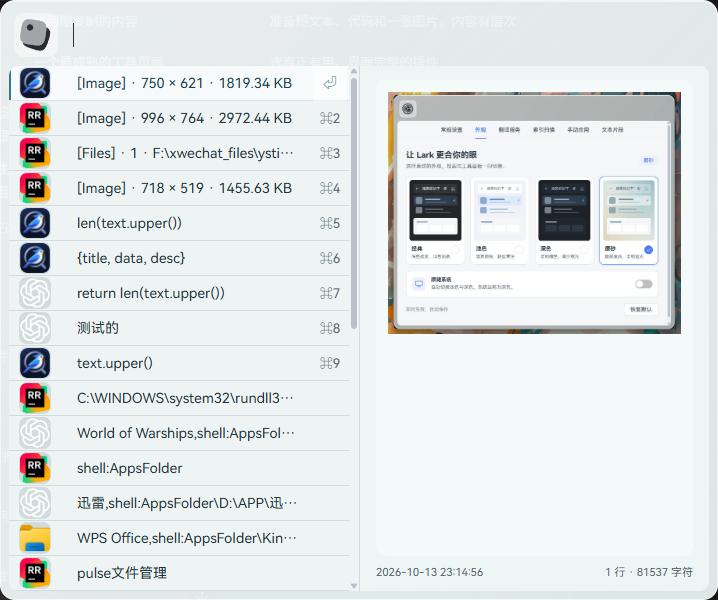

# Lark

<div align="center">

**用一个快捷键，连接你的桌面工作。**

应用启动 · 文件搜索 · 剪贴板历史 · 插件工具

[下载](https://github.com/ystianxie/Lark/releases) · [快速开始](#快速开始) · [开发运行](#开发运行) · [插件开发](docs/插件开发规范.md)

</div>



Lark 是一款基于 Tauri、Rust 和 React 构建的桌面效率工具。按下快捷键，输入关键词，就能启动应用、查找本地文件、打开网址或使用插件；常用操作集中在一个搜索框里，减少来回切换。

目前主要面向 Windows 开发，代码中也包含 macOS 支持；不同平台的系统集成能力有所差异。

## 功能

| 功能 | 你可以做什么 |
| --- | --- |
| 应用启动 | 按名称、拼音或拼音首字母查找应用，回车启动；常用应用优先展示 |
| 文件搜索 | 搜索本地文件名和路径，直接打开文件或定位所在文件夹；自定义索引范围与排除规则 |
| 剪贴板历史 | 保存、搜索和预览文本、图片及文件记录，快速复用复制过的内容 |
| 即时工具 | 输入数学表达式计算结果，打开 URL，或将关键词发送到搜索引擎 |
| 插件扩展 | 在组件库中管理插件，使用关键词调用工具，创建 JavaScript 或 Python 插件 |
| 外观设置 | 切换经典、浅色、深色和磨砂主题，支持跟随系统明暗变化 |

### 应用搜索

输入名称或拼音，使用方向键选择结果，按回车启动。Windows 下还支持尝试激活已经运行的应用窗口。

<details>
<summary>查看应用搜索截图</summary>



</details>

### 文件搜索

在空搜索框中按 `Tab` 进入文件搜索模式。索引范围可以在设置中调整，搜索结果支持直接打开和定位所在文件夹。

<details>
<summary>查看文件搜索截图</summary>



</details>

### 剪贴板历史

找回之前复制的文字、图片或文件，在同一个窗口中浏览记录和预览内容。历史记录的保留数量与清理规则可以在设置中调整。

<details>
<summary>查看剪贴板截图</summary>



</details>

### 插件与组件库

搜索「组件库」进入插件管理页面，查看工具说明和调用关键词，开启或关闭插件。内置创建向导支持生成 JavaScript / Python 插件，也可以自行编写插件页面和动作。

仓库中的示例插件见 [`plugins/`](plugins/)，插件格式、配置项和宿主 API 见 [插件开发规范](docs/插件开发规范.md)。Python 插件需要可用的 Python 环境，可在应用设置中指定解释器。

## 快速开始

1. 前往 [Releases](https://github.com/ystianxie/Lark/releases) 查看可用安装包；如没有适合的平台版本，可以从源码运行。
2. 启动 Lark，按首次使用向导完成设置，等待初始索引建立。文件较多时，首次索引需要一些时间。
3. 按快捷键呼出搜索框，输入应用名称；在空输入框中按 `Tab`，即可搜索本地文件。
4. 搜索「应用设置」调整快捷键、索引范围与外观，搜索「组件库」管理插件。

### 常用快捷键

| 操作 | Windows | macOS |
| --- | --- | --- |
| 呼出搜索框 | `Alt + Space` | `Option + Space` |
| 打开剪贴板历史 | `Ctrl + Alt + V` | `Shift + Command + V` |
| 进入文件搜索 | 空输入框中按 `Tab` | 空输入框中按 `Tab` |
| 选择上一项 / 下一项 | `↑` / `↓` | `↑` / `↓` |
| 执行选中结果 | `Enter` | `Enter` |
| 打开应用或文件所在目录 | `Alt + Enter` | `Command + Enter` |
| 快速选择可见结果 | `Alt + 1…9` | `Command + 1…9` |
| 清空输入或退出当前模式 | `Esc` | `Esc` |

以上为默认快捷键，全局快捷键可在设置中修改。部分系统功能仅在 Windows 上可用。

## 开发运行

需要 Node.js、pnpm、Rust，以及对应平台的 [Tauri 2 开发环境](https://v2.tauri.app/start/prerequisites/)。Windows 还需要 Microsoft C++ Build Tools 和 WebView2。

```bash
git clone https://github.com/ystianxie/Lark.git
cd Lark
pnpm install
pnpm tauri dev
```

其他常用命令：

| 命令 | 用途 |
| --- | --- |
| `pnpm dev` | 启动 Vite 前端开发服务 |
| `pnpm build` | 构建前端 |
| `pnpm preview` | 预览已构建的前端 |
| `pnpm tauri build` | 构建桌面应用安装包 |
| `cargo check` | 检查 Rust 代码，在 `src-tauri/` 中执行 |
| `cargo test` | 运行 Rust 测试，在 `src-tauri/` 中执行 |

完整体验请使用 `pnpm tauri dev`，因为应用启动、本地索引和剪贴板等系统功能依赖 Tauri。当前打包配置为 Windows NSIS 安装包，其他平台需按需调整构建配置。

### 项目结构

```text
src/                       React 界面、功能面板与主题
src-tauri/src/             Rust 后端与系统集成
src-tauri/win-file-drop/   Windows 文件拖放支持
plugins/                   示例插件及资源
docs/                      技术说明与开发规范
规划/                      功能计划
show/                      README 展示图片
```

技术栈：Tauri 2 · Rust · React 19 · Vite · Ant Design · SQLite。

## 文档与反馈

- [插件开发规范](docs/插件开发规范.md)：插件目录、Manifest、配置与 API
- [皮肤与主题](docs/皮肤与主题.md)：外观配置与平台差异
- [剪贴板快速粘贴](docs/文本结果快速粘贴机制.md)：历史内容的复用方式
- [项目功能与现状摸底](docs/项目功能与现状摸底.md)：阶段性功能与技术盘点，具体实现以当前代码为准

项目持续开发中。遇到问题或有功能建议，欢迎提交 [Issue](https://github.com/ystianxie/Lark/issues)，尽量附上系统版本、复现步骤和截图。

## 许可证

仓库目前未提供独立的开源许可证。使用、修改或分发前，请向维护者确认授权范围。
