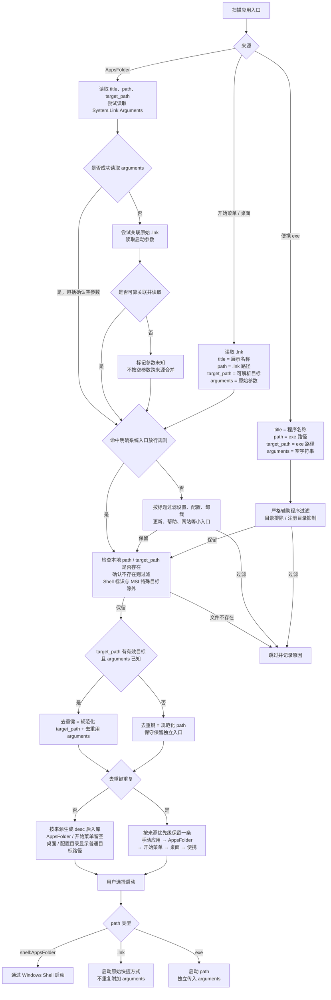

# Windows 应用索引扫描与过滤流程

更新时间：2026-10-12。`target_path` 保存解析目标，`desc` 独立负责展示。AppsFolder 参数读取、快捷方式关联及统一去重已实施，并支持虚拟 Shell 目标读取与图标获取。开始菜单和桌面先扫描并缓存元数据，入库优先级仍是手动应用、AppsFolder、开始菜单、桌面、便携 exe。

其中几个边界需要明确：

- `title` 负责展示、过滤，以及辅助关联 `.lnk`，**不作为最终启动去重键**。
- `target_path` 相同且去重用参数相同，才确认普通目标重复；工作目录本轮不参与。原始 `arguments` 仍用于启动和保存。
- AppsFolder 参数“读取失败”和“确认无参数”必须区分，可用一个内部状态记录，不能都直接视为 `arguments = ""`。
- AppsFolder 与 `.lnk` 确认重复后，保留 AppsFolder 的 `path` 和图标。
- 没有普通目标的“运行”“控制面板”等入口，保留原始 `path`，不强行转换成 exe。

## 字段与展示规则

| 字段 | 用途 |
|---|---|
| `title` | 应用名称，辅助过滤和快捷方式关联 |
| `path` | 启动入口，保留 `.lnk`、AppsFolder 标识或 exe |
| `target_path` | 解析得到的目标，保存普通文件路径或 Shell 标识，供去重、参数关联、文件存在检查、目录抑制及目标图标读取使用 |
| `desc` | 只用于界面展示，不参与目标识别、去重或存在检查 |
| `arguments` | 原始启动参数 |

| 最终保留项的来源 | `desc` |
|---|---|
| AppsFolder | 空字符串 |
| 开始菜单 | 空字符串 |
| 桌面 | `target_path` 是带盘符的普通路径时显示，否则为空 |
| 配置的应用目录 | 显示普通目标路径 |
| 手动添加 | 显示普通目标路径 |

- 普通路径保留空格、中文与原始大小写，只展开环境变量、去外层引号并统一斜杠。Shell 标识和 MSI `.ico` 元数据不放进 `desc`。
- 来源优先级决定重复项最终展示：桌面条目与 AppsFolder 重复时保留 AppsFolder，`desc` 为空，不从桌面复制展示路径。
- “打开所在文件夹”读取 `target_path`，不读取 `desc`；只有普通文件路径才提供这个操作。目标不是普通路径或属于 `.ico` 元数据时，可以使用原始 `.lnk` 的所在目录；纯 AppsFolder Shell 入口不显示该操作提示。
- 数据库新增 `target_path` 列，首次迁移在事务中将旧 `desc` 的目标保存到新列；未解析目标的 `.lnk` 保持空目标。Windows 旧 AppsFolder/开始菜单记录的 `desc` 同时清空，迁移不会在后续启动时重复用 `desc` 覆盖 `target_path`。完整来源展示规则在重建索引后生效，启动仍使用 `path`。

## 参数关联与去重细则

- AppsFolder 直接读取 `System.Link.Arguments`。属性不存在、类型不支持或转换失败时，内部状态为未知；成功读到空字符串才算确认无参数。
- 未知参数从本轮已扫描的 `.lnk` 元数据补查：`title` 去首尾空白并忽略大小写，快捷方式标题还允许使用与 AppsFolder 相同的可启动扩展名处理规则，例如 `RPA-2.rdp` 与 `RPA-2`；`target_path` 展开环境变量并统一路径格式。标题与目标都匹配才是候选，实际展示名称和启动路径不修改。
- 当 `target_path` 是 `::{...}` 形式的 Shell 标识时，以相同 `target_path` 关联 `.lnk`，允许 `title` 因语言不同而不同，例如 `Run` 与“运行”。参数读取与冲突规则仍然适用。
- 所有候选都成功读取参数，且 `arguments` 完全一致时，才采用该参数；候选缺失、任一参数未知或存在冲突时保留未知状态。
- 快捷方式使用 `IShellLinkW` 读取目标与参数，不要求有起始位置，不执行或 Resolve 快捷方式。`GetPath` 返回空时，从 `GetIDList` 取得 PIDL，并用 `SHGetNameFromIDList` 读取 Shell 标识作为 `target_path`，因此“运行”“控制面板”等虚拟目标也可跨来源去重。损坏文件跳过，有效但仍无法解析目标的 `.lnk` 保留原始 `path`。
- 开始菜单/桌面快捷方式的 `target_path` 允许 `exe/com/msc/bat/cmd/rdp` 和 Shell namespace；`http/https/mailto`、`html/htm/url/chm/ico` 及其他文档、网页、图标目标默认排除，以下两类特殊快捷方式除外。
- 例外：如果 `.lnk` 包含 Windows Installer 的 `DarwinDataBlock`，它属于广告式 MSI 快捷方式，例如 `Charles.lnk`。即使 `target_path` 是 `.ico`，也保留原始 `.lnk`，启动时交给 Windows Shell/Installer 处理；普通目标为 `.ico` 且无法恢复真实目标的快捷方式仍然排除。
- 另一类异常快捷方式可从工作目录恢复：当目标不是可启动类型时，仅在工作目录存在且只有一个 `.exe` 的文件名（去掉空格和标点后）与 `title` 完全匹配时，使用该 exe 作为 `target_path`；原始 `.lnk` 仍保存在 `path`，启动仍交给 Windows Shell。AMD Privacy View 即属于此类。
- AppsFolder 的 `target_path` 使用同一套目标类型判断，先拒绝 `http/https/mailto`，再识别 `shell:`、`::{...}` 和可启动文件，避免无斜杠的 URL 被误识别为 `.com`。
- 可信快捷方式仍按标题过滤小入口：`使用说明`、`帮助`、`意见反馈`、`打字入门`、`皮肤下载`、`细胞词库`、`检查更新`、`Help`、`Manual`、`Documentation`、`Release Notes`、`Install/Installer` 等直接排除；系统主入口不使用这些标题。
- AppsFolder（含补查参数后）及开始菜单/桌面 `.lnk` 还检查 `target_path + arguments` 的网页转发组合：目标程序为 `rundll32.exe`，参数模块为 `url` / `url.dll`，入口为 `OpenURL` / `OpenURLA` / `OpenURLW` / `FileProtocolHandler`，且目的地址以 `http://` 或 `https://` 开头时排除。模块可以是完整路径，支持引号、大小写和分隔空白；目标缺失时也可识别 `path` 中直接包含的 rundll32 路径。参数未知时不猜测。普通应用带 URL 参数、其他 DLL 或系统控制面板用途不因本规则排除，显式手动应用不受自动发现过滤影响。过滤在占用去重键、目录抑制和图标读取前完成，日志标记为“跳过网页启动入口（rundll32 URL 转发）”。
- 所有来源统一调用 `app_entry_key(path, target_path, arguments)`。有目标且参数已知时使用结构化的目标与去重用参数组合；当前仅将 `/from=任意值` 规范化为 `/from`，用于合并不同启动来源，原始参数不修改并继续用于启动和入库。其他参数保留原有文本语义；参数未知时使用原始入口 `path`，工作目录不参与去重。
- 原始 `.lnk` 路径保存在 `path`；AppsFolder 重复项保留原来的 `path` 和图标。`UNIQUE(path)` 仍用于避免同一启动入口重复写入，跨来源去重在扫描阶段完成。
- AppsFolder 图标依次尝试包内 logo、原始 `path` 的 Shell 图标、`target_path` 的目标图标。`shell:` 和 `::{...}` 使用 `IShellItemImageFactory` 获取图标，不作为普通文件路径处理；“运行”和“文件资源管理器”的裸 GUID 无法直接获取图标，但其 AppsFolder `path` 可以。

## 文件存在检查

- 自动扫描入库前，检查 `path` 和 `target_path` 中带盘符的绝对路径，例如 `C:\...`、`D:/...`；先展开环境变量并去除外层引号。`shell:AppsFolder\C:\...` 这种包含真实路径的入口也检查其中的文件路径。
- `.lnk` 入口还存在但普通 `target_path` 目标已删除时，也过滤。广告式 MSI 快捷方式只检查原始 `.lnk` 的 `path`，不根据 `target_path` 判断失效。
- 空目标、相对路径、未展开的环境变量、Shell 标识、UNC 路径及映射网络盘不做文件存在检查。检查报错时记录日志并保留，只有确认文件不存在才过滤；图标是否为空不参与此判断。
- 开始菜单和桌面的失效入口在参数关联前剔除，避免给 AppsFolder 补充过期参数；过滤项不占用去重键，不抑制便携程序目录。显式添加的手动应用不受自动扫描过滤影响。
- 检查只读取文件元数据，不读取程序内容或启动程序，在图标提取前完成。同一轮重建共享路径结果与盘符类型缓存，下一轮重新检查。`[AppIndexTrace] 文件存在检查完成` 日志记录 `unique_paths`、`cache_hits`、`skipped_entries` 和 `elapsed_ms`（实际元数据查询与盘符检查的累计耗时）。
- 本机一次只读测量：559 个 AppsFolder/开始菜单/桌面入口，574 个不同路径、316 次缓存命中，检查环节总耗时约 45 ms，其中实际查询约 33 ms。该数值为本机当次结果，冷缓存、不同磁盘和安全软件可能影响实际耗时。

## 验证范围

回归测试覆盖各来源的空参数键一致、不同参数共存、未知参数保守保留、关联冲突、环境变量目标、AppsFolder 图标优先、原生快捷方式参数与 PIDL 目标读取、不同语言标题的 Shell 入口去重、按来源显示路径、空 `desc` 时目标与参数的数据库往返及旧目标迁移。本机 Windows 集成测试验证“运行”“控制面板”“文件资源管理器”的 AppsFolder 图标可读取并解码。

本机只读检查确认：WeGame 与英雄联盟WeGame版的 AppsFolder 参数属性未提供，而对应开始菜单 `.lnk` 都有同名同目标及确认空参数，因此可通过关联合并各自的重复入口。应用重建与实际启动效果仍需在新版本中核验。
